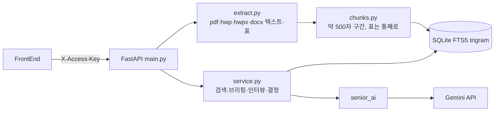

# 졸업하지 않는 선배 · Backend

FastAPI + SQLite(FTS5 trigram) API 서버입니다. AI 로직은 [AI 저장소](https://github.com/woowangthon/WOOWANGTHON_TEAM_06_AI)의 `senior_ai` 패키지를 import해서 씁니다. (AI 우왕톤 TEAM 06)

- 배포 API: https://senior-be.onrender.com (`/api/health`만 공개, 나머지는 접근 키 필요)
- 화면: https://woowangthon-team-06-fe.vercel.app
- 배포 서버의 데이터는 직접 만든 **가상 데이터(가명)** 입니다.

## 구조



흐름: 파일 업로드 → 텍스트·표 추출(빨간 글씨는 `{{r:...}}`로 보존) → 구간 분할 → FTS5 색인 → 질문 시 관련 구간 검색 → 모델이 그 구간만으로 답변 → 인용이 원문에 있는지 검증 → 근거와 함께 응답.

## 기술 선택

- **SQLite FTS5 trigram:** 별도 벡터 DB와 임베딩 없이 한국어 부분 일치 검색을 해결했습니다. 조직 하나의 기록 규모에는 충분하고 배포가 단순합니다.
- **표를 쪼개지 않음:** 타임테이블 같은 표는 한 구간으로 색인해 질문하면 표 전체를 보여 줍니다.
- **AI 로직 분리:** 모델·프롬프트 변경이 서버에 영향을 주지 않습니다. 모델 호출 실패는 502로 알리고, 첫 화면(작년 이맘때)은 미리 뽑아 둔 일정으로 동작해 AI 없이도 뜹니다.
- **브리핑 캐시:** 만든 브리핑을 DB에 저장하고, 기록이 바뀌면 무효화해 모델 호출을 줄입니다.
- **접근 키:** 로그인 대신 `APP_ACCESS_KEY` 하나로 접속을 제한합니다.

## API 요약

| 메서드 | 경로 | 설명 |
| --- | --- | --- |
| GET | `/api/health` | 상태 확인(키 불필요) |
| GET/POST | `/api/cohorts` | 기수 |
| GET/POST | `/api/records` | 기록 목록·등록 |
| POST | `/api/records/upload` | 파일 업로드(multipart, 최대 20MB) |
| GET/PATCH/DELETE | `/api/records/{id}` | 기록 조회·수정·삭제 |
| GET | `/api/records/{id}/pdf` | 원본 PDF |
| GET | `/api/timeline/last-year` | 작년 이맘때 일정 카드 |
| GET | `/api/briefing` | AI 브리핑 |
| POST | `/api/ask` | 근거 기반 답변 |
| GET | `/api/tables` | 표 검색 |
| POST | `/api/interviews/next`, `/api/interviews/answer` | 퇴임 인터뷰 |
| POST | `/api/decisions/suggest` | 결정 초안(저장하지 않음) |
| GET/POST | `/api/decisions` | 결정 조회·저장 |
| GET | `/api/graph`, `/api/stats` | 지식 그래프, 통계 |

전체 명세는 실행 후 `/docs`(OpenAPI)에서 볼 수 있습니다. 오류: 입력 400, 없는 자료 404, AI 호출 실패 502, 키 없음 401.

## 로컬 실행

세 저장소를 같은 폴더에 clone합니다(`AI/`, `Backend/`, `FrontEnd/`).

```bash
cd Backend
python3 -m venv .venv && source .venv/bin/activate
pip install -r requirements.txt
pip install -e ../AI                   # 로컬 개발: 옆 폴더의 AI 저장소를 바로 반영
cp .env.example .env
python -m app.seed                     # DB를 가상 시드로 초기화
uvicorn app.main:app --port 8000       # http://localhost:8000/docs
```

- `LLM_PROVIDER=fake`(기본): 키가 필요 없는 규칙 기반 답변.
- `LLM_PROVIDER=gemini` + `GEMINI_API_KEY`: 실제 답변.
- `LLM_PROVIDER=claude`: 로컬에 로그인된 `claude -p` 사용(로컬 전용).
- 테스트: `pytest` (항상 fake 모델, 네트워크 없음)

## 문서 올리기

- 화면의 기록 탭에서 PDF, hwp, hwpx, docx, txt를 올립니다. 올린 문서에서 날짜를 찾아 일정에 연결합니다.
- PDF는 원본이 저장되어 "원본 확인하기"로 그대로 볼 수 있습니다. hwp·hwpx·docx는 LibreOffice가 설치된 환경(로컬)에서만 PDF로 변환해 보여 주고, 없으면 텍스트로 보여 줍니다. 배포 서버(Render)에는 LibreOffice가 없어 **PDF만 원본 확인**이 됩니다.
- 한꺼번에 가져오기: `python -m scripts.import_docs <폴더>` (기존 데이터를 지우고 가져옴), `--append`로 추가. 실제 문서와 `data/app.db`는 실명이 있어 git에 올리지 않습니다.

## 배포 (Render, 무료 플랜)

`render.yaml`은 디스크(`/var/data`)가 있는 유료 플랜(Blueprint)용 설정이고, 제출한 배포는 같은 명령을 대시보드에서 직접 입력한 **무료 웹 서비스**입니다(디스크 없음, `DB_PATH=/tmp/app.db`).

1. Render에서 이 저장소를 웹 서비스로 연결합니다(`pip install -r requirements.txt`, `uvicorn app.main:app --host 0.0.0.0 --port $PORT`).
2. 환경 변수: `APP_ACCESS_KEY`(접근 키), `CORS_ORIGINS`(프론트엔드 주소), `LLM_PROVIDER=gemini`, `GEMINI_API_KEY`, `DB_PATH=/tmp/app.db`, `SEED_DEMO=1`.
3. 무료 플랜은 디스크가 없어 DB가 `/tmp`에 있습니다. **재시작하면 초기화**되고, `SEED_DEMO=1`이면 시작할 때 가상 시드가 다시 들어갑니다. 올린 문서는 서버가 꺼지면 사라집니다.
4. 한동안 접속이 없으면 서버가 잠들어 첫 응답에 30~60초가 걸립니다.
5. `APP_ACCESS_KEY`가 있으면 `/api/health`를 뺀 모든 API가 `X-Access-Key` 헤더를 요구합니다.

## 한계

- Gemini 무료 키는 하루 호출 한도가 있어, 한도를 넘으면 AI 답변이 일시적으로 실패합니다.
- 배포 서버는 영구 저장소가 없습니다(위 참고).
